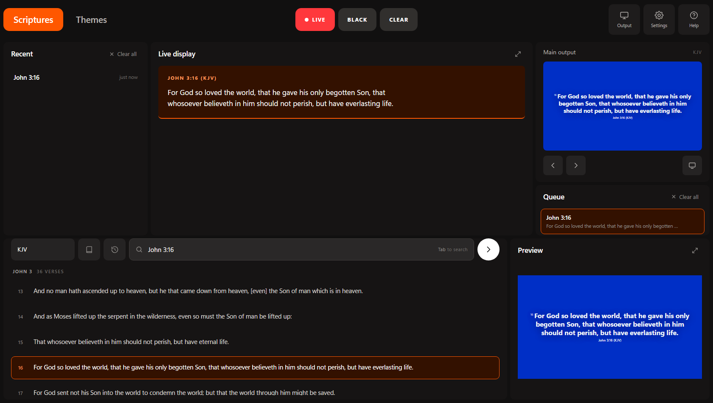
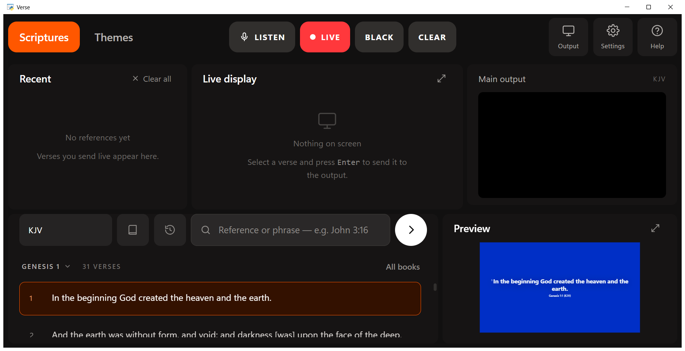
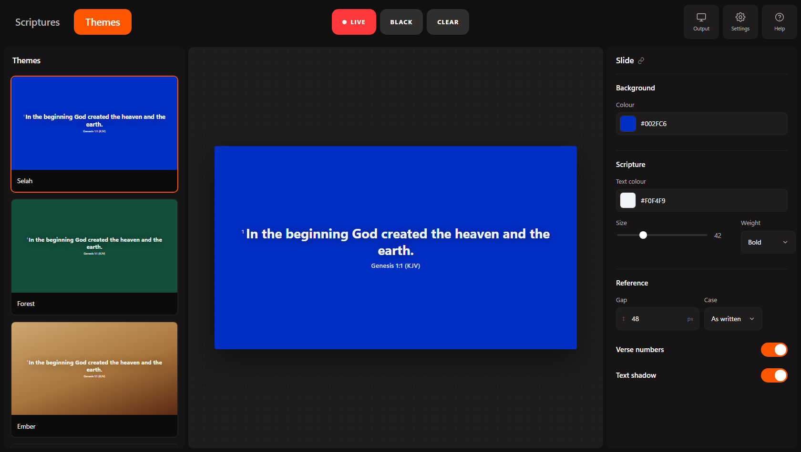
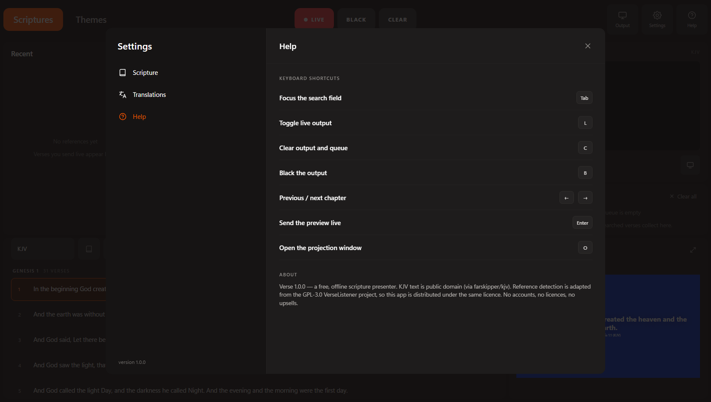

# Verse

A free, offline scripture presenter for church screens — search a reference or a phrase, preview
the slide, send it live. No account, no licence key, no transcription subscription, no upsells.



## Run it

It runs as a desktop application window, not a browser tab:

```bat
:: Windows — double-click run.bat, or:
cd verse
.venv\Scripts\python app.py
```

One-time setup (needs pip, once):

```bat
python -m venv .venv
.venv\Scripts\pip install -r requirements.txt
```

That installs pywebview (the window), psutil (the memory watch), vosk + sounddevice (offline
transcription) and ndi-python + windows-capture (NDI output). The app still starts without any of
the optional ones — the feature that needs it says so in Settings instead of failing.



The window is a **WebView2 host**: the Chromium engine built into Windows that Teams, Outlook and
WhatsApp also use. It has no tabs, no address bar, no bookmarks and no extensions, gets its own
taskbar entry, keeps its own window position, and cannot be navigated away from. Closing the window
stops the loopback server it started.

`python app.py --browser` serves the same UI to your normal browser instead — handy for devtools or
on macOS/Linux. `python serve.py` alone still does the plain serving, `--port` pins a port.

The server is standard library only, binds `127.0.0.1` on the first free port from 8777, and serves
nothing outside this folder.

### Why a web engine instead of native Qt widgets?

The original is PyQt6, and its Qt build only loads inside the frozen `VerseListener.exe` — a
standalone PyQt6 install is a ~60 MB dependency that has to match the interpreter exactly. A
WebView2 window uses an engine every Windows 10/11 machine already ships, so the app starts in well
under a second with no runtime to install. The trade-off is honest: these are HTML widgets in a
native window, not native Qt widgets, so focus rings, menus and scrolling follow Chromium rather
than Win32.

## What it does

- **Reference search** — type `john 3:16`, `romans 8 28`, `ps 23`, `2 tim 3 16`, `first corinthians 13`.
  Abbreviations, spoken numbers and `through/thru/to/-` ranges all resolve.
- **Keyword search** — type a phrase (`the Lord is my shepherd`) and get TF‑IDF ranked verses with
  the matching words highlighted, plus an exact-quote boost.
- **Manual browsing** — the book icon (or **All books**) opens every book; the heading
  (`GENESIS 1 ⌄`) opens a grid of every chapter, and clicking a verse stages it. Type nothing,
  press nothing else — useful mid-service. Arrow keys still step chapters, 31,102 KJV verses in all.
- **Translations** — KJV, the World English Bible, and Biblica's Open Yoruba and Open Igbo
  Contemporary Bibles, picked from the dropdown beside the book icon or in Settings → Translations.
  A translation is only loaded the first time it is chosen, so opening the app still parses one
  file; anything already on the projection window is re-rendered in the new text and clamped to the
  verses that translation actually has. Notices and sources are in [BIBLES.md](BIBLES.md); licensed
  Bibles (NIV, NKJV…) are imported from the owner's own copy — see
  [Adding a translation](#adding-a-translation).
- **Live output** — a second native window shows the slide, `F11` fullscreens it; the host owns the
  window, so nothing can block it. Slides stay in sync through `localStorage`, which also means
  `output.html` works standalone in any window.
- **Configurable output** — Settings → Output picks a window, a fullscreen display (any monitor, by
  index), or an **NDI** source: the projection window is captured with Windows Graphics Capture and
  published under the name you choose, so vMix, OBS, Studio Monitor, a hardware encoder or another
  machine on the network pick `Verse` up directly. No HDMI splitter, no capture card, and whatever is
  on the wall — including blackouts and theme changes — is exactly what leaves on the wire.
- **Transcription** — `Listen` (or `M`) turns the microphone into references. **Local** runs fully
  offline and is the one to use in a service: **Whisper base.en** (default, ~141 MB downloaded once)
  understands Nigerian and other accented English far better than **Vosk**, the ~40 MB streaming
  alternative kept for low-memory machines. Both are loaded only while listening. The third option,
  **Browser**, uses the Web Speech engine inside the app window — nothing to download, needs
  internet, and can be blocked in an app window. Local records from the microphone you pick, or
  **Automatic**, which skips phone-as-webcam and streaming-cable inputs and takes the first real
  microphone — the common reason a service "hears nothing" is Windows defaulting to a virtual
  camera. A small meter beside Live display moves with the input, so silence is visible at a glance.
  A spoken "Romans chapter eight verse twenty eight" becomes `Romans 8:28` in the heard line,
  staged in the preview or sent straight live. Whisper endpoints on a half-second pause and then
  reads the whole sentence; Vosk streams partials every 100 ms and acts on a finished verse while
  the sentence is still being spoken.
- **Voice commands** — with the microphone listening, say **“next verse”**, **“previous verse”**,
  **“next chapter”**, **“previous chapter”**, or **“change the Bible to Yoruba”** (King James, World
  English, Yoruba, Igbo). Only the whole sentence counts, so a sermon line such as “let us go to the
  next verse” moves nothing. Commands can be turned off in Settings → Transcription.- **Detection** — finds a verse that was never named out loud: an exact five-word quotation in
  0.4 ms, then embeddings in 33–70 ms, then a cross-encoder to separate near-misses. 68 ms average
  from transcript to verse, p95 188 ms. Settings → Detection installs the models, builds a Bible's
  own vectors (Yoruba and Igbo need them; English can borrow what is already on this machine) and
  sets how sure is sure. See [Finding a verse nobody named](#finding-a-verse-nobody-named).
- **Two speech pipelines** — Whisper tiny.en answers while the sentence is still being spoken;
  base.en replaces it with the accurate reading once the room goes quiet. The fast pass stands down
  whenever the accurate one is busy, so the two never compete for the same cores.
- **Memory guard** — the host samples the whole process tree (Python, WebView2 browser, GPU and
  renderers) every three seconds. At 900 MB the page drops the TF‑IDF index and old queue entries; at
  1500 MB it releases everything droppable and says so. A loaded detection model declares its own
  footprint and the limits rise by that much while it is in use, so the watchdog cannot release the
  model it is meant to protect. Settings → Usage and → Performance show the live figure, the split
  between the host and WebView2, the peak, the limits in force, and a manual **Release** button. Every
  model is dropped as soon as listening stops.
- **Queue** — searched/sent verses collect here; `Go` re-sends one.
- **Themes** — five slide presets plus colour, size, weight, reference gap, case, verse numbers and
  text shadow, all edited live on a canvas.- **Settings** — display mode, translation, reference format, theme; a translations page listing
  every installed Bible with its licence and how to import one you own; a detection page for the
  models and the indexes; a performance page with per-stage latency, memory and tuning advice; a help
  page with the shortcut list.

| | |
|---|---|
|  |  |

## Keyboard

| Key | Action |
|---|---|
| `Tab` | focus the search field |
| `Enter` | send the preview live |
| `L` | toggle live output |
| `B` | black the output |
| `C` | clear output and queue |
| `←` `→` | previous / next chapter |
| `O` | open the projection window |
| `M` | start / stop listening |
| `Esc` | close a menu or the settings sheet |
| `F11` | fullscreen the projection window (app only) |


Deep links: `index.html?ref=John%203:16&live=1` opens at a verse (and puts it on air);
`?view=themes` opens the theme editor.

## How the search works

`assets/js/engine.js` is a port of VerseListener's detector:

- a 66-book alias table (`"1 samuel"`, `"1samuel"`, `"i samuel"`, `"first samuel"`), matched
  **longest-first** so `1 thessalonians` wins over a shorter alias;
- one compiled pattern over that table, with a negative lookbehind so mid-word text never matches and
  an alias that doesn't resolve aborts the match (`"John Cena 5"` stays silent);
- typed queries additionally accept the spoken `Book 3 16` form and glued ordinals (`2tim 3 16`);
- `2nd Timothy` and `third John` normalise to the same digits, and a word one edit away from a book
  name — followed by a number — is rescued, so an accented "romas 8:28" still lands;
- a short "chapter thirty four, verse twenty" or "verse twenty three" is resolved against the last
  book heard, because preachers name the book once;
- results are clamped to what the canon actually contains (`John 3:999` → `John 3:36`).

Keyword search builds a TF‑IDF index over every verse once (≈1 s, lazily, on the first phrase
search), scores with cosine similarity over an inverted index, and multiplies the score by 1.6 when
the verse contains the typed phrase verbatim.

`tools/test_engine.js` covers the detector cases, reference parsing/clamping, the streaming-partial
rules, canon sanity and three ranking cases:

```bash
node tools/test_engine.js
```

## Finding a verse nobody named

Everything above needs the reference to be *said*. Most of a sermon is not: the preacher reads the
verse aloud, or describes it, and the reference never leaves his mouth. Four tiers handle that, and
each one only runs when the one before it was not sure.

| Tier | What it matches | Where it runs | Cost |
|---|---|---|---|
| direct | "turn to Romans chapter eight verse twenty eight" | the page (`engine.js`) | ~0.015 ms |
| shingle | "the Lord is my shepherd, I shall not want" — five words in a row | the host (`shingle.py`) | **0.4 ms** |
| semantic | "the pastor said we should put off the old man" — never quoted | the host (`semantic.py`) | **33–70 ms** |
| rerank | tells two near-identical verses apart | the host (`rerank.py`) | 45–152 ms per 6 candidates |

Through the real window, from transcript in hand to verse ready to show: **68 ms average, 188 ms at
p95**. The direct and shingle tiers answer in under a millisecond, which is why the order matters —
seven of the nine utterances below never loaded a model at all.

### The semantic tier

The same design Pewbeam uses offline: EmbeddingGemma-300m (4-bit ONNX, 768 dimensions) embeds the
sentence on the CPU, then one matrix-vector product against a matrix holding a vector for every
verse. At 31,078 verses that matrix is 91 MB and the scan is about 5 ms, so an exact search beats
any approximate index on both speed and recall. `IndexFlatIP`, in FAISS terms; `numpy.memmap` here,
so the pages are file-backed and the OS can drop them instead of the app holding memory it is not
using.

Measured on this machine, nine utterances that a preacher might say:

| Said | Found | Tier | Confidence |
|---|---|---|---|
| "for god so loved the world that he gave his only begotten son" | John 3:16 | shingle | 1.00 |
| "the lord is my shepherd i shall not want" | Psalms 23:1 | shingle | 1.00 |
| "i can do all things through christ who strengthens me" | Philippians 4:13 | shingle + semantic | 0.99 |
| "we are more than conquerors through him that loved us" | Romans 8:37 | shingle | 1.00 |
| "those who wait upon the lord shall renew their strength" | Isaiah 40:31 | shingle + semantic | 0.92 |
| "nothing can separate us from the love of god" | Romans 8:35 | shingle | 1.00 |
| "the pastor said we should put off the old man and put on the new" | Colossians 3:9 | semantic | 0.51 |
| "the youth camp will hold its annual meeting on saturday morning" | — | rejected | 0.12 |
| "remember to turn off your phones before the service begins" | — | rejected | 0.18 |

The two rejected sentences are the point of the reranker. The embedding scores them 0.49–0.51, well
above any floor that also keeps the paraphrase at 0.46; reading the pair together with
ms-marco-MiniLM gives them a logit of 0.0 and the paraphrase +2.4, and that separation is what makes
the difference. Without the reranker installed the English floor rises to 0.55 on its own, which
rejects the noise but also declines the paraphrase — a straight trade, taken deliberately.

**Confidence is calibrated, not invented.** 0.42 is where English candidates stop being right and
0.75 is a near-quotation; the page then applies its own strictness (Strict 0.62, Balanced 0.40,
Eager 0.24) before a verse moves on its own. Nothing reaches the output without either that or the
operator pressing Enter.

### What is installed, and what to build

| Piece | Size | Notes |
|---|---|---|
| embedding model | 209 MB | Settings → Detection → Install. If Pewbeam is installed on the same machine, its copy is used as-is: nothing is downloaded and nothing is written there. |
| cross-encoder | 23 MB | Optional. Without it, near-misses cannot be separated. |
| verbatim index | ~6 MB per Bible, cached | Built on first use in about a second. |
| own verse vectors | 91 MB per Bible | Built by you, one hour of CPU per English Bible. |

**An index belongs to one language.** EmbeddingGemma does not place Yoruba or Igbo text near its
English meaning — a Yoruba psalm queried against an English index lands at rank 7,298 — so those
translations need vectors built from their own words. That is what `tools/build_index.py` is for:

```bash
python tools/build_index.py --status          # what is built, what is not
python tools/build_index.py --translation yor # one Bible
python tools/build_index.py --all             # Yoruba, Igbo, then KJV and WEB
```

It writes as it goes and records its position, so stopping it — or the machine — costs one batch of
eight verses, and starting it again continues from there. The app exposes the same thing in
Settings → Detection → Build, with a live percentage and a Stop button. Expect about 54 minutes per
English Bible and 75 minutes per Yoruba/Igbo one on an eight-core CPU: 4 threads and batches of 8
measured fastest, and more threads or bigger batches were both slower.

A verse *quoted* in Yoruba or Igbo is found today, with no index at all — the verbatim tier reads
that Bible's own text. Only the "described but never named" case needs the vectors.

### Memory

Idle, with the model released: **473 MB** across the seven WebView2 and host processes. Listening
with everything loaded: **821 MB**, peaking at 900. Releasing gives 350 MB back, measured. The
188 MB model and its 91 MB matrix load when Listen is pressed or the first semantic query arrives,
and are dropped when listening stops — `Settings → Detection` has the switch, and the Release
button.

The watchdog in `memory.py` is why this does not creep. It samples the whole process tree, and when
the total passes its limit it drops what can be rebuilt: the keyword search index, old queue
entries, and the detection model. A loaded stack *declares its own footprint*, and the limit moves up
by that much while it is in use — otherwise the watchdog would release the model under its own feet
and the next utterance would pay two seconds to reload it. `Settings → Performance` shows the split
between the host process and WebView2, the peak, the limits in force, and the advice that comes out
of the numbers (Pewbeam's `get_optimization_recommendations`, pointing at settings that exist).

## Speed and accents

There are two very different local engines, and the trade-off is honest:

| | Vosk small | Whisper base.en |
|---|---|---|
| transcript | partials every 100 ms | a whole sentence at the pause |
| time to a verse | when the words are spoken | ~1 s after the speaker pauses |
| model | 40 MB | 141 MB |
| accented English | misses most references | resolves nearly all of them |

`tools/bench_latency.py` replays a synthesised sentence at speaking speed through the real listener
and timestamps every partial and the final result:

```bash
python tools/bench_latency.py --engine whisper
python tools/bench_latency.py --engine vosk --block 4000   # compare block sizes
```

Whisper is not a streaming recogniser: it reads a completed window, so the listener watches the input
level, keeps a 300 ms pre-roll, and transcribes when the room has been quiet for half a second. On
this machine that is about a second after the last word, including about 0.5 s of inference. Vosk
streams partials and can act while the sentence is still being spoken — but only if it heard the
words correctly. The page no longer acts on an unfinished reference: a number that could still grow
("verse twenty") or a bare chapter waits one block, so `Romans 8:20` never flashes before `8:28`.

### Two pipelines, and what the fast one is worth

The instant pipeline runs Whisper **tiny.en** (75 MB) beside base.en on the same audio. It reads the sentence about a
second in, while it is still being spoken, and pushes what it has as an interim transcript; base.en replaces it with
the accurate reading at the pause. `check_speech.py` asserts that both really ran and that the accurate one still
resolves the reference, so a fast pass that replaced a good answer with a worse one would fail the check.

Measured on a long sentence where the reference comes early: *"Turn with me please to Romans chapter eight verse
twenty eight as we continue our study in this epistle tonight…"*

| | Reference complete |
|---|---|
| accurate pass alone | **10.74 s** — after the speaker stops |
| with the fast pass | **5.69 s** |

Five seconds earlier, and both end on the same verse. The fast pass stands down whenever the accurate one is
transcribing, so the two never compete for the same cores. Switch it off in Settings → Transcription; without it
nothing else changes.

### What was measured

The comparison used Microsoft's neural voices for **en-NG** (Abeo and Ezinne) and **en-KE**
(Chilemba), six spoken references each, clean and mixed with noise at 15 dB and 10 dB SNR:

| Engine | clean | 15 dB | 10 dB |
|---|---|---|---|
| Vosk small en-US | 3/18 | — | — |
| Whisper base.en | 18/18 | 17/18 | 16/18 |

End-to-end through the shipping listener — paced audio, endpointing, Whisper, detector — resolved
**35/36** of the same samples. The one miss was "Deuteronomy" heard as "due to Romans" at 15 dB.
That is the remaining class of error: a book name Whisper never heard cannot be rescued by the
detector. A wired microphone or a feed from the desk is worth more than any further tuning.

The detector itself is kept accent-tolerant in four ways: the Whisper prompt lists all 66 books so
the decoder prefers those spellings; `2nd`/`3rd` and spelled-out ordinals normalise to digits; a word
that is one edit from a book name and followed by a number is rescued ("romas 8:28" →
`Romans 8:28`); and a bare "chapter thirty four, verse twenty" is resolved against the last book
said. Detection costs 0.015 ms per sentence, so none of the delay comes from the page.

## Adding a translation

Verse ships with KJV, WEB, Yoruba and Igbo — see [BIBLES.md](BIBLES.md) for the notices. To add a
Bible you have the rights to (a licensed NIV or NKJV of your own, or any other text you may use):

1. Produce `{"Genesis 1:1": "…", …}` (any JSON with `Book Chapter:Verse` keys), or use an eBible
   `--vpl` verse-per-line file.
2. Run the converter, which writes `assets/js/data.<id>.js`:

   ```bash
   python tools/build_translation.py --json my-bible.json \
     --id niv --short NIV --title "New International Version" \
     --language English --licence "Used under my licence" --source "my copy"
   ```

3. Add a matching entry to `assets/js/translations.js`. The picker on the Scriptures screen and the
   list in Settings → Translations are both driven by that array.

Only public-domain and Creative-Commons texts can be redistributed with Verse. `tools/build_translation.py
--vpl` also accepts eBible.org downloads, which is how the bundled Yoruba and Igbo editions were made.
The KJV still comes from the bundled VerseListener canon via `tools/build_canon.py`.

## Layout

```
verse/
  app.py                desktop host: server + WebView2 window + bridge
  speech.py             local Whisper + Vosk engines, model downloads, microphone stream
  memory.py             process-tree watchdog and pressure thresholds  ndi_out.py            NDI sender (window capture -> network source)
  detect.py             the detection ladder: shingle -> semantic -> rerank
  shingle.py            hashed five-word verbatim index, one cache per Bible
  semantic.py           EmbeddingGemma (ONNX) + the flat verse-vector matrix
  rerank.py             int8 MiniLM cross-encoder (optional, fail-open)
  canon.py              reads the app's own Bible files from Python
  perf.py               per-stage latency, memory, grade and the advisor
  requirements.txt      pywebview, psutil, faster-whisper, vosk, sounddevice, ndi-python, windows-capture, onnxruntime, tokenizers
  index.html            app shell (Scriptures, Themes, Settings sheet)
  output.html           projection window (full-bleed slide)
  serve.py              stdlib server + launcher
  run.bat               Windows double-click launcher
  assets/
    css/app.css         design tokens + every component
    js/engine.js        alias table, detector, canon accessors, TF-IDF search
    js/app.js           state, rendering, live output, themes, settings
    js/translations.js  the bundled Bibles and their notices
    js/data.js          generated KJV canon (4.2 MB)
    js/data.web.js      World English Bible, loaded on demand
    js/data.yor.js      Open Yoruba Contemporary Bible, loaded on demand
    js/data.ibo.js      Open Igbo Contemporary Bible, loaded on demand
  BIBLES.md             sources and copyright notices for every bundled Bible
  tools/
    build_canon.py      KJV verses.json -> data.js
    build_translation.py VPL/JSON -> data.<id>.js (any translation)
    test_engine.js      node tests for the engine
    bench_latency.py    paced replay: speech -> partial -> final timings
    check_speech.py     synthesised speech through the real listener
    check_features.py   drives the real window: translations, transcription, memory, NDI
    check_detect.py     drives the real window: quoted, described and rejected utterances
    bench_detect.py     detection latency per tier, and memory at each stage
    build_index.py      builds one Bible's verse vectors, resumably
  docs/                 screenshots
```

## Checks

```bash
node tools/test_engine.js                 # detector, parsing, ranking
python app.py --selftest                  # window, projection, live slide
python tools/check_speech.py              # synthesised speech -> both local engines -> Romans 8:28
python tools/check_speech.py --wav my-voice.wav --expect "Romans 8:28" --engine whisper
python tools/bench_latency.py --engine whisper   # speech -> final latency
python tools/check_features.py            # translations, browsing, mic, memory trim, NDI
python tools/check_detect.py              # offline detection, end to end (30 checks)
python tools/bench_detect.py              # latency per tier and memory at each stage
python tools/build_index.py --status      # which Bibles have their own vectors
```

`check_speech.py` needs no microphone: Windows' own synthesiser speaks a sentence into a WAV file
and the real listener replays it at speaking speed, once through Whisper and once through Vosk. Point
it at a recording of your own voice with `--wav` to hear exactly how your accent is transcribed.`check_features.py` opens the microphone briefly, exercises voice commands and both local engines,
and streams the projection window over NDI. `check_detect.py` opens no microphone at all: it injects
nine real utterances down the same path the microphone uses — quoted, described, paraphrased and
plainly not scripture — and asserts what reaches the preview. `bench_detect.py` reports the latency
of each tier and the memory at every stage. All of them print PASS/FAIL per step and exit non-zero
on failure.

## Design

The visual language is a deliberate copy of the reference mockups in
`../design/PEWBEAM_DESIGN_SPEC.md` (a separate analysis of a commercial worship app's UI): one accent
(`#ff5700`), a five-step charcoal ramp, a red `LIVE` signal, and the "on-air" burnt tint `#331100`.
Every hex in `app.css` was sampled from those screenshots. Anything that existed only to sell a
subscription — Account, licence keys, plan upgrade, locks on settings — is deliberately absent.

## Licence

The reference detector is adapted from [VerseListener](https://github.com/anclatechs/verse-listener),
which is GPL‑3.0, so this project is GPL‑3.0 too — see [LICENSE.md](LICENSE.md). The KJV text is
public domain, via [farskipper/kjv](https://github.com/farskipper/kjv).
